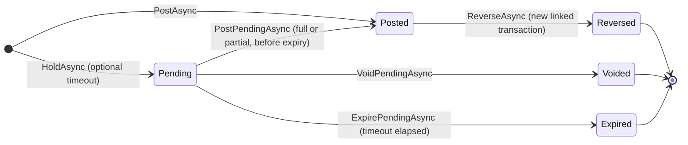

# ledger-dotnet

[](https://github.com/victorcondackdev/ledger-dotnet/actions/workflows/ci.yml)

A double-entry ledger core for .NET 8: the part of a fintech or BaaS platform
that owns accounts and balances and must never be wrong. Balanced multi-leg
transactions, two-phase transfers, idempotent retries, reversals instead of
updates, and a SHA-256 hash-chained audit log, behind an async storage
interface designed to map one-to-one onto a SQL transaction.

It is a port of [ledger-go](https://github.com/victorcondackdev/ledger-go),
and the two are **byte-compatible**: the same history produces the same
transaction hashes and the same audit chain head in both languages, which the
test suite proves against vectors generated by the Go implementation.

No dependencies beyond the .NET 8 base class library. Trimming and AOT
compatible.

```
src/Ledger/               the library (package Ledger)
  Monetary/               Money (long minor units + ISO 4217), Allocate, pt-BR formatting
  GeneralLedger*.cs       accounts, transactions, two-phase transfers, queries, audit chain
  InMemory/               concurrency-safe in-memory ILedgerStore (reference implementation)
tests/Ledger.Tests/       unit, example, simulation and cross-language parity tests
samples/Ledger.Demo/      runnable digital-bank scenario (output identical to the Go demo)
benchmarks/               BenchmarkDotNet write-path benchmarks
tools/vecgen/             Go program that generates the parity vectors
```

## Why

Most ledger bugs are not arithmetic bugs; they are invariant bugs that only
show up under concurrency, retries or partial failure. This library makes the
invariants the API:

- **Atomic invariants.** Every write is one `ILedgerStore.UpdateAsync`: debits
  equal credits per currency, posting currency matches the account, frozen
  accounts receive nothing, `NoOverdraft` accounts never go below zero
  *available* (pending holds included). A rejected request leaves no trace.
- **Two-phase transfers.** `HoldAsync` then `PostPendingAsync` (full or
  partial), `VoidPendingAsync` or expiry: card authorization and capture, Pix
  funds blocked under MED, escrow.
- **Immutable history.** Nothing is ever updated. Refunds are `ReverseAsync`:
  a new transaction mirroring the original and linked to it.
- **Idempotency built in.** Same key and same request returns the original
  transaction; same key and a different request is an error, even when the two
  race on different accounts.
- **Tamper evidence.** Each transaction stores SHA-256(previous hash ||
  canonical encoding). `VerifyChainAsync` detects any edited, inserted, deleted
  or reordered row and returns a head hash you can anchor externally.
- **Tested like a distributed system.** A seeded simulation runs concurrent
  transfers, holds, partial captures, reversals, retries, conflicting retries,
  freezes and expiry sweeps with an auditor checking the trial balance from
  live snapshots, then asserts the global invariants.

## Concepts

| Concept | Meaning |
|---|---|
| `Money` | `long` minor units plus a `Currency`; exact, overflow-checked, never a `double` or `decimal`. |
| `Account` | Id, chart code, currency, type (asset, liability, equity, revenue, expense), normal balance (derived from the type, overridable for contra accounts), flags `NoOverdraft`, `Frozen`. |
| `Posting` | One leg: account, `Debit`/`Credit`, positive `Money`. |
| `Transaction` | Immutable sealed record: id (UUIDv7), gap-free `Seq`, kind, idempotency key, `Ref` to a related transaction, timestamp, description, metadata, postings, request hash, previous hash, hash. |
| `Balances` | Four counters per account (debits/credits x posted/pending) plus a version. `Balance` interprets them as posted, pending and available on the normal side. |
| `Entry` | Effect of one leg on one account with the counters right after it: the source for statements and point-in-time balances. |

Transfer lifecycle:



A hold moves pending counters only. Posting it releases the whole hold and
posts the captured amount; for multi-leg holds (amount plus fee) the captured
amount is spread over the legs with `Money.Allocate`, so the split is preserved
to the centavo.

## Quick start

```csharp
using Ledger;
using Ledger.InMemory;
using Ledger.Monetary;

var ledger = new GeneralLedger(new InMemoryLedgerStore());

await ledger.OpenAccountAsync(new Account { Id = "asset:reserves", Currency = Currency.BRL, Type = AccountType.Asset });
await ledger.OpenAccountAsync(new Account { Id = "wallet:alice", Currency = Currency.BRL, Type = AccountType.Liability, Flags = AccountFlags.NoOverdraft });
await ledger.OpenAccountAsync(new Account { Id = "wallet:bob", Currency = Currency.BRL, Type = AccountType.Liability, Flags = AccountFlags.NoOverdraft });
await ledger.OpenAccountAsync(new Account { Id = "revenue:fees", Currency = Currency.BRL, Type = AccountType.Revenue });

Money amount = Money.Parse(Currency.BRL, "250.00");
Money fee = Money.Parse(Currency.BRL, "0.99");
Posting[] postings =
{
    Posting.Debit("wallet:alice", amount + fee),
    Posting.Credit("wallet:bob", amount),
    Posting.Credit("revenue:fees", fee),
};

Transaction tx = await ledger.PostAsync(new PostRequest
{
    IdempotencyKey = endToEndId, // the Pix EndToEndId: retries return the original
    Description = "Pix to Bob",
    Postings = postings,
});
// Rejections throw LedgerException and write nothing:
//   catch (LedgerException e) when (e.Code == LedgerError.InsufficientFunds) { ... }
//   catch (LedgerException e) when (e.Code == LedgerError.IdempotencyConflict) { ... }

// Two-phase: authorize R$ 250,99, capture R$ 100,00 (legs scaled), release the rest.
Transaction hold = await ledger.HoldAsync(new PostRequest { Postings = postings, Timeout = TimeSpan.FromDays(7) });
await ledger.PostPendingAsync(new ResolveRequest { Id = hold.Id, Amount = Money.Parse(Currency.BRL, "100.00") });

// Refund.
await ledger.ReverseAsync(new ResolveRequest { Id = tx.Id, IdempotencyKey = "refund-" + endToEndId });

// Queries and audits.
Statement page = await ledger.GetStatementAsync("wallet:alice", new StatementOptions { Limit = 50 }); // page.NextCursor
Balance endOfDay = await ledger.GetBalanceAtAsync("wallet:alice", cutoff);
TrialBalance tb = await ledger.GetTrialBalanceAsync(); // tb.Check()
ChainHead head = await ledger.VerifyChainAsync();      // anchor head.Hash externally
```

`Money` formats without `CultureInfo`, so output is the same everywhere:

```csharp
Money.Parse(Currency.BRL, "1234.56").Format(MoneyLocale.PtBR); // "R$ 1.234,56"
Money.Parse(Currency.BRL, "0.05").Allocate(70, 30);            // [BRL 0.04, BRL 0.01]
Money.Parse(Currency.BRL, "100.00").Split(3);                  // [BRL 33.34, BRL 33.33, BRL 33.33]
```

For an end-to-end scenario with statements, a trial balance and the chain head:

```
dotnet run --project samples/Ledger.Demo
```

## Cross-language hash-chain parity

The canonical encoding (fixed-width big-endian integers, length-prefixed UTF-8
strings, metadata sorted byte-wise by key, nanosecond Unix timestamps) and the
SHA-256 chain are byte-identical to
[ledger-go](https://github.com/victorcondackdev/ledger-go). A ledger built by
the same operations in either language has the same transaction hashes, the
same request fingerprints, the same statement cursors and the same chain head,
so a Go service and a .NET service can audit each other's history, and a chain
head notarized by one can be verified by the other.

This is enforced, not claimed. [`tools/vecgen`](tools/vecgen/main.go) runs the
Go implementation and writes
[`GoVectors.g.cs`](tests/Ledger.Tests/Parity/GoVectors.g.cs):

- **Money tables:** currency table, `Parse`, `ParseLocale`, formatting
  (decimal, pt-BR, en-US) and `Allocate` over fixed edge cases and seeded
  random inputs, including overflow and malformed text.
- **Two complete ledger scenarios**, emitted as data: a scripted one that walks
  through every feature and every rejection path, and a seeded random one with
  hundreds of transfers with fees, holds with timeouts, partial captures,
  voids, expiry sweeps, reversals, replays, conflicting retries, freezes,
  multi-currency postings and Unicode metadata (keys chosen so that UTF-16
  ordinal order and UTF-8 byte order disagree). For every step the vectors hold
  the outcome Go observed: the transaction id, sequence number and hash, or the
  exact error.

`ParityTests` replays each scenario step by step against `GeneralLedger` with
the same deterministic clock and id generator and asserts every outcome, every
sealed transaction (hash, previous hash, request hash, postings after partial
capture scaling), every statement page and cursor, the trial balance,
point-in-time balances and finally the chain head. The demo is checked the
same way: CI diffs its output against the Go demo's, including the head hash.

## Design notes

**Long minor units.** Amounts are integers of the currency's minor unit (`BRL`
2, `JPY` 0, `KWD` 3, `CLF` 4). Every operation is overflow-checked and throws
`MoneyException` instead of wrapping; balances are checked the same way.
Parsing is digit by digit and rejects anything it would have to round.

**Allocation with 128-bit intermediates.** `Allocate` uses the largest
remainder method with `UInt128` products (`magnitude * ratio / total`), so no
input can overflow, the parts always sum exactly to the amount, each part is
within one minor unit of its exact share, and `long.MinValue` splits correctly.
Ties go to the earlier part, as in Go.

**Formatting without culture data.** `Format` and `ParseLocale` implement
grouping and separators themselves and never consult `CultureInfo`, ICU or
NLS. Output is identical on Linux, Windows, macOS, in containers running with
invariant globalization (CI runs the suite that way too) and in Go.

**Lock ordering.** A write locks exactly the accounts it touches, sorted by id
(byte order of UTF-8) and deduplicated, with one `SemaphoreSlim` per account.
Because every writer acquires locks in the same global order, no cycle of
waiters can form: transfers A to B and B to A at the same instant serialize
instead of deadlocking, and transfers on disjoint accounts do not contend on
account locks at all. The order is: account semaphores, then the chain-head
semaphore (taken late, only to seal and append), then a short monitor around
publishing the new snapshot with no `await` inside it. In SQL it is
`SELECT ... ORDER BY account_id FOR UPDATE` followed by
`SELECT ... FROM chain_head FOR UPDATE`.

**Snapshot reads.** The in-memory store keeps committed state in immutable
collections and replaces it atomically on commit. Readers never block
writers, and a view always observes whole transactions: the trial balance the
simulation's auditor computes while transfers run always sums to zero.

**The chain head is a deliberate serialization point.** A single hash chain
gives a total order (`Seq`) and tamper evidence over the whole history, at the
cost of one global critical section per commit. In memory it is short:
everything that can fail is validated before the head is taken. In SQL the
row lock is held until `COMMIT`, durable flush included, so a single chain
caps write throughput at roughly one commit latency per transaction. That is
the honest trade-off of this design; sharded chains with checkpoints are on
the roadmap.

**Idempotency semantics.** Keys live in one namespace across all operations.
Each request is fingerprinted (SHA-256 of a canonical encoding of the
operation and its inputs) and the fingerprint is part of the sealed
transaction. Inside the update, a key that already exists returns the stored
transaction if the fingerprint matches and `IdempotencyConflict` otherwise.
Two first-time requests with the same key can both see it as free when they
lock different accounts; the store's unique constraint decides at commit
(`DuplicateIdempotencyKey`, a unique violation in SQL) and the loser retries
once, which turns into a replay or a conflict. Replays do not fire commit
hooks.

**Why reversals, not updates.** A posted transaction is a fact that downstream
systems have observed. A reversal is a new fact with its own timestamp, linked
by `Ref`, subject to the same invariants (it fails with `InsufficientFunds` if
the money already left a `NoOverdraft` account, which is exactly the MED
partial recovery problem), and the audit chain stays verifiable.

**Point-in-time balances without replay.** Each entry stores the counters
after it, and timestamps are clamped to be non-decreasing along the chain, so
`GetBalanceAtAsync` is one binary search and statement running balances come
for free. Cursors are keyed on the per-account entry sequence, so pages are
stable while new activity arrives.

**Async-first, synchronous when it can be.** The API returns `ValueTask` so a
SQL store can be truly asynchronous, while the in-memory store completes
synchronously without allocating tasks. The clock is a `TimeProvider`; ids
are UUIDv7 from a small built-in generator (`Guid.CreateVersion7` needs
.NET 9). Hooks registered in `LedgerOptions.OnCommit` run after commit,
outside all locks: a wake-up signal for an outbox relay, which reads the
gap-free `GetTransactionsAsync(afterSeq, limit)`.

## Testing

```
dotnet test                                          # everything
dotnet test --filter FullyQualifiedName~Parity       # Go parity only
dotnet run -c Release --project benchmarks/Ledger.Benchmarks -- --filter '*'
go -C tools/vecgen run . > tests/Ledger.Tests/Parity/GoVectors.g.cs   # regenerate vectors (needs ../ledger-go)
```

Besides the parity suite, the tests port the Go suite (validation, idempotency
including the commit-time key race, freezes, two-phase transfers, expiry,
reversals, pagination, hooks, cancellation), tamper with stored rows to prove
`VerifyChainAsync` and `VerifyBalancesAsync` catch edits, deletions and
reorderings, and run the concurrent simulation: 8 workers on seeded
generators, then trial balance zero (posted and pending), no `NoOverdraft`
account negative, money conserved, no pending amounts left, every idempotency
key mapped to exactly the transaction its caller saw, a valid chain, balances
equal to a replay of entries, and one commit hook per transaction. With one
worker the run is reproducible down to the chain head.

## Roadmap

- EF Core / PostgreSQL `ILedgerStore` with the reference schema from ledger-go
  (`SELECT ... FOR UPDATE` in id order, unique indexes for keys and reversals,
  serialization-failure retries) and a transactional outbox table.
- Multi-currency FX postings through FX position accounts, with rate and
  source in sealed metadata.
- Partial reversals (MED partial recovery) with cumulative tracking.
- Sharded audit chains with periodic checkpoints for higher write throughput.
- Snapshot and restore for the in-memory store.

## License

MIT, see [LICENSE](LICENSE).
